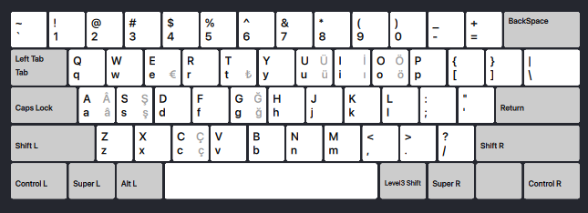

# TRKEY
### US layout with Turkish letters on AltGr.



## Windows

1. [Download TRKEY-setup.exe from the latest release](https://github.com/enxg/TRKEY/releases/latest/download/TRKEY-setup.exe) and run it. It asks for admin rights.
    - The installer isn't signed, so SmartScreen may say "Windows protected your PC". Click More info → Run anyway.
2. In the installer, you can tick Also add TRKEY (US) under English (United States). It's unticked by default.
3. Switch layouts with <kbd>Win</kbd>+<kbd>Space</kbd>. TRKEY is listed under Turkish. If it isn't there yet, sign out and back in

**Uninstall:** Settings → Apps → Installed apps → TRKEY (US) keyboard layout → Uninstall. Restart afterwards to finish removing the DLL.

## macOS

```bash
curl -fsSL https://github.com/enxg/TRKEY/releases/latest/download/install.sh | sh
```
Then:
1. Log out and back in.
2. System Settings → Keyboard → Input Sources → Edit… → + → Turkish → TRKEY (US).

> If you don't want to run the script, follow the [instructions in the wiki](https://github.com/enxg/TRKEY/wiki/Manual-Install-macOS) to manually install TRKEY.

**Uninstall:** Remove TRKEY from Input Sources first, then run:
```bash
curl -fsSL https://github.com/enxg/TRKEY/releases/latest/download/install.sh | sh -s -- --uninstall
```

## Linux

### Wayland

```bash
curl -fsSL https://github.com/enxg/TRKEY/releases/latest/download/install.sh | sh
```
Log out and back in, then add TRKEY (US) in your keyboard layout settings, where it's listed under Turkish.

### X11

```bash
curl -fsSL https://github.com/enxg/TRKEY/releases/latest/download/install.sh | sh -s -- --system
```
Then select it with `setxkbmap trkey`, or make it permanent with the xorg.conf.d snippet the script prints.

> If you don't want to run the script, follow the [instructions in the wiki](https://github.com/enxg/TRKEY/wiki/Manual-Install-Linux) to manually install TRKEY.


## Using TRKEY

On Windows and Linux, the Turkish characters are on <kbd>AltGr</kbd> (right <kbd>Alt</kbd>). On macOS they're on <kbd>Option</kbd>.
